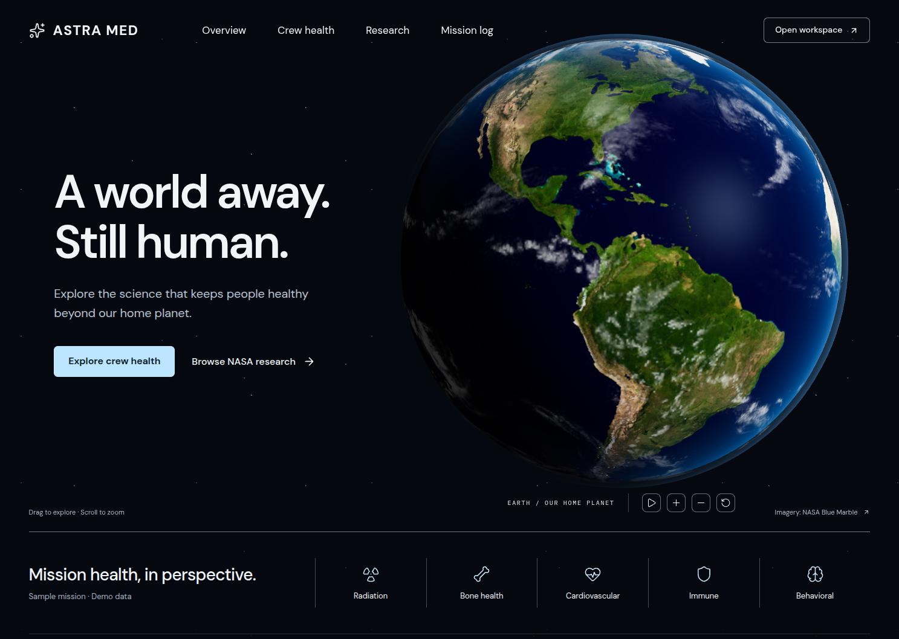

# ASTRA-MED

**Astronaut health monitoring and exploration decision support.**

ASTRA-MED brings daily health observations, mission health indicators, space-weather information, and structured guidance into one crew-focused workspace. It helps users record changes, review areas that need attention, and prepare information for mission medical support.

*Homepage preview with demonstration data.*

## Overview

Space missions place people in environments where health observations, available resources, and communication delays matter. ASTRA-MED organizes these concerns around a practical workflow: observe, record, review, and prepare.

The experience begins with an interactive view of Earth and opens into a dashboard for check-ins, health-domain monitoring, space weather, protocol review, medical inventory, and research evidence.

## Features

| Capability | What it provides |
| --- | --- |
| **Interactive Earth** | A rotating 3D globe with NASA surface imagery, cloud layers, atmospheric lighting, and drag, zoom, pause, and reset controls. |
| **Daily health check-ins** | Records heart rate, blood pressure, blood oxygen, sleep, mood, exercise, and symptoms, with a history of previous entries. |
| **Health-domain monitoring** | Reviews radiation, bone, cardiovascular, immune, and behavioral indicators through scores, trends, and suggested actions. |
| **Space-weather awareness** | Displays solar energetic particle events, timestamps, instruments, and source links. |
| **Exploration decision support** | Organizes reported symptoms into ranked guidance and reviewable protocol steps. |
| **Medical inventory** | Tracks kit quantities and flags low stock, expired items, and supply issues relevant to a protocol. |
| **Research evidence** | Connects users to NASA space-biology data, technical reports, and human-research resources. |

## How it works

1. **Review the mission overview.** Explore the health domains and identify areas that need attention.
2. **Record a daily check-in.** Add observations and readings to the mission log.
3. **Review patterns and context.** Compare health indicators with previous entries and available space-weather information.
4. **Prepare a response.** Review guidance, work through protocol checklists, and check the required supplies.
5. **Consult the evidence.** Follow research and source links for further context.

## The experience

ASTRA-MED combines a spacious Earth-focused homepage with a structured mission workspace. Responsive layouts support desktop and mobile use, while keyboard-accessible globe controls, reduced-motion support, and an image fallback make the opening experience usable across different devices.

The application supports both a standalone demonstration mode and a backend-connected mode. The demonstration uses simulated crew records; the connected workspace reads and saves information through the application's API.

## Technology

| Layer | Technologies |
| --- | --- |
| Interface | React, TypeScript, Vite, and CSS |
| Earth visualization | Three.js and NASA Blue Marble imagery |
| API | Python and FastAPI |
| Persistence | SQLAlchemy and PostgreSQL |
| Verification | Vitest, Playwright, and backend API tests |

## Project documentation

- [Frontend guide](frontend/README.md) — local development, configuration, and frontend deployment.
- [Backend guide](backend/README.md) — API setup, database configuration, and backend tests.
- [Earth imagery credits](frontend/public/textures/CREDITS.md) — sources for the globe's surface, cloud, and night textures.

## Contributors

[@10kash](https://github.com/10kash) · [@Youngjay42-real](https://github.com/Youngjay42-real)

## Project scope

ASTRA-MED is an independent exploration research prototype intended for simulated crew scenarios. It is not a clinical or operational mission medical system and does not replace qualified medical care.
